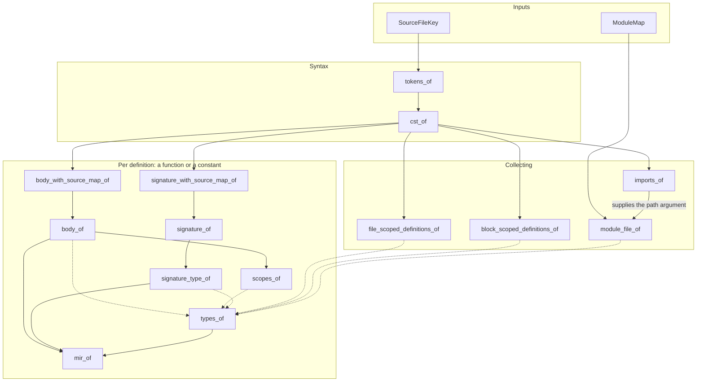

<div align="center">
  
  <h1>blueberry</h1>
  <p>simple and expressive programming language</p>
</div>

## Installation

### Requirements

- Rust
- LLVM 22

The build needs to find LLVM 22. If `llvm-config` (from LLVM 22) isn't on your `PATH`, which is the case by default with Homebrew and apt, point the build at LLVM's install directory with `LLVM_SYS_221_PREFIX`:

```sh
# macOS (brew install llvm@22)
export LLVM_SYS_221_PREFIX="$(brew --prefix llvm@22)"

# Ubuntu/Debian (apt install llvm-22-dev)
export LLVM_SYS_221_PREFIX=/usr/lib/llvm-22
```

To set it once for every `cargo` command (including your editor's rust-analyzer), add it to `~/.cargo/config.toml` instead:

```toml
[env]
LLVM_SYS_221_PREFIX = "/usr/lib/llvm-22"  # or the output of `brew --prefix llvm@22`
```

### Building from Source

1. Git clone the repository

```sh
git clone https://github.com/simontran7/blueberry.git
```

2. Change directory 

```sh
cd blueberry/
```

3. Build

```sh
cargo build --release
```

4. Move the `target/release/blueberry` binary to a desired location (e.g. in `/Users/<username>`), then add it to your `PATH` by adding the following line to your `.bashrc` file

```sh
# in your .bashrc
export PATH=$PATH:<path to the compiler executable>
```

## Usage

Run `blueberry --help` to see available commands and options.

## Language Reference

See [A Tour of Blueberry](docs/tour-of-blueberry.md).

## Architecture

The compiler core is based on the [**query-based architecture**](https://ollef.github.io/blog/posts/query-based-compilers.html). 

Queries are memoized thanks to [salsa](https://github.com/salsa-rs/salsa).

The core is designed language-server-first: it's the base for both the batch compiler (`src/batch`) and the language server (`src/language_server`), which reach it only through one facade, `core::program::Program`. The facade answers questions in the core's own terms (a file and an offset in, diagnostics, a type or a definition's location out), and everything behind it (the HIR, its stores and source maps, types, MIR) is private to the core (`pub(in crate::core)`), so the compiler enforces the boundary. Everything specific to a client stays in that client: rendering and sorting diagnostics for the terminal in `src/batch`, and the language server protocol in `src/language_server`.

While the language server calls the queries depending on the interactions, the batch compiler calls the queries as follows:



Each stage is explained in its own document:
- See [Syntactic Analysis](docs/syntactic-analysis.md) for how source text becomes a concrete syntax tree.
- See [Semantic Analysis](docs/semantic-analysis.md) for how the concrete syntax tree is lowered to an high-level intermediate representation form, how names are resolved, and how types are inferred and checked.
- See [MIR Construction](docs/mir-construction.md) for how the HIR is lowered to a mid-level intermediate representation.
