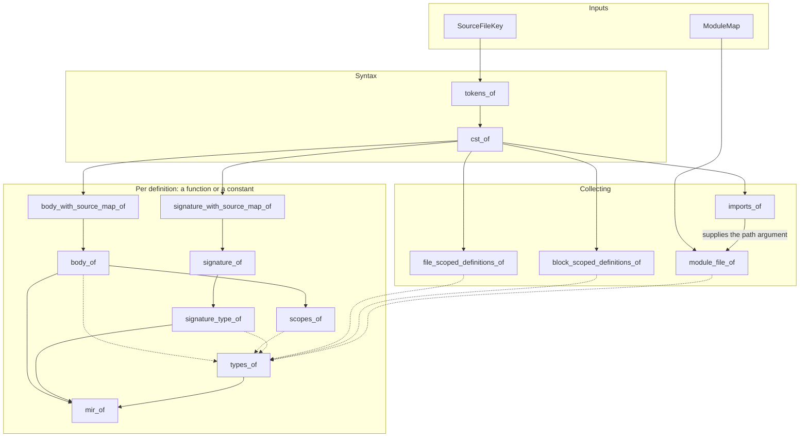

# Docs

## Architecture

The compiler core is based on the [**query-based architecture**](https://ollef.github.io/blog/posts/query-based-compilers.html). Every stage is a set of queries, computed the first time something needs them and cached afterwards:



Read them in the order a program goes through them:

1. [Database](core/database.md): `Compiler` (the core's facade), the database, its inputs, the module map, and how a project is loaded
2. [Lexical Analysis](core/lexical-analysis.md): source text to tokens (not written yet)
3. [Syntactic Analysis](core/syntactic-analysis.md): tokens to a concrete syntax tree
4. [Semantic Analysis](core/semantic-analysis.md): what each name refers to, and what type each expression has
5. [MIR Construction](core/mir-construction.md): the typed HIR to a control-flow graph in SSA form

## Testing

```bash
cargo test
```

Most tests are snapshot tests: see [Testing](testing.md) to add one.

## Running the Compiler

`check` runs a file through every stage, and reports the first stage's errors, in the file and in everything it imports (`build` and `run` aren't implemented yet):

```bash
cargo run -- check --path=main.bb
```

`--emit` also prints what a stage produced, for the compiled file. It takes one or more of `tokens`, `cst`, `hir` (with each expression's type), and `mir`:

```bash
cargo run -- check --path=main.bb --emit=hir,mir
```

Imports are resolved from the directory of the compiled file.

## Style

Follow the [Style Guide](style-guide.md), including its commit messages.
