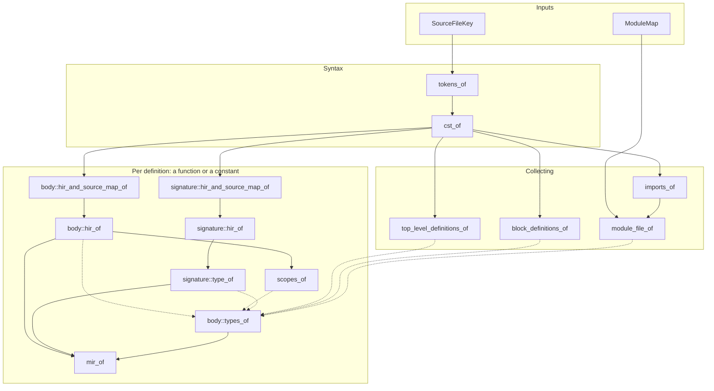

# Docs

## Architecture

The core compiler is based on the [**query-based architecture**](https://ollef.github.io/blog/posts/query-based-compilers.html). Every stage is a set of queries, computed the first time something needs them and cached afterwards:

1. [Lexical Analysis](architecture/lexical-analysis.md): source text to tokens 
2. [Syntactic Analysis](architecture/syntactic-analysis.md): tokens to concrete syntax trees
3. [Semantic Analysis](architecture/semantic-analysis.md): concrete syntax trees to a typed high-level intermediate representation
4. [MIR Construction](architecture/mir-construction.md): typed high-level intermediate representation to a mid-level intermediate representation (control-flow graph in SSA form)

## Testing

See [Testing](testing.md).

## Style

See [Style Guide](style-guide.md).
